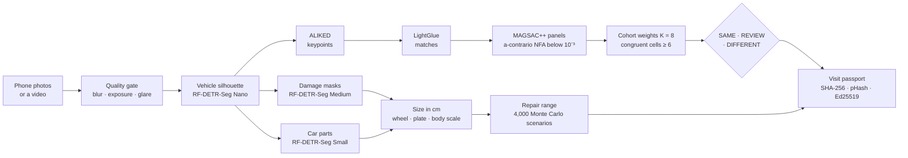

<div align="center">

# CarPrint · Verification AI

**Same car? What is new since the last visit? What will the repair cost?**<br>
CarPrint answers from phone photos — with evidence anyone can check.

Team **Antigradient** · WEST Hackathon 2026 · Computer Vision track (automotive industry & road safety)<br>
Partner product for **Royal Motors After-Sales** (Toyota, BYD) — vehicle check-in / check-out at service reception

[](https://huggingface.co/spaces/Azamaka/carprint-demo)
[](https://antigradient.uz)
[](https://huggingface.co/spaces/Azamaka/carprint-demo)


**[Try it on the website](https://antigradient.uz)** · **[HF demo + API](https://huggingface.co/spaces/Azamaka/carprint-demo)** ·
**[Model report](docs/MODEL_REPORT.md)** ([designed page](https://claude.ai/artifact/2BiC1Seyz1qAyA1wzUsgLs)) ·
**[Defence deck](https://claude.ai/artifact/Hga6Km2HXvmizwBST95TAA)**

</div>

---

## At a glance

| | |
|:---:|---|
| **0 / 400** | false "same car" on different cars (200 of the same model, 200 of other models); 95 % upper bound 1.5 % |
| **0.880** | mAP@0.5 of car-part segmentation, 21 classes |
| **0.248** | mAP@0.5 of damage segmentation, 7 classes (+40 % against our 12-epoch run) |
| **≈ 3 s** | photo → damage → part → size → repair range on the GPU server |
| **$0.0003** | GPU time of one 8-frame inspection on a T4 ($0.40 / h) |

Every finding is confirmed by a person: the system shows evidence and a range, it never bills or rejects on its own.

## What it does

1. **Is this the same physical car as last time?** `SAME / REVIEW / DIFFERENT`, decided from individual marks
   (curb rash, chips, scratches) after discounting the design every car of the same model shares.
2. **What changed?** A per-part damage timeline: recorded before · new · gone · not visible.
3. **What will it cost?** A repair range P10 – P50 – P90 per part, from measured size and public Tashkent prices.
4. **Can the record be trusted?** SHA-256 and perceptual hashes against recycled photos, an Ed25519-signed,
   hash-chained passport per vehicle; plate and VIN are kept only as an HMAC.

## Try it

| Where | What you get |
|---|---|
| **[antigradient.uz](https://antigradient.uz)** | comparison studio with the AI verdict next to a geometric baseline; **AI Damage Scan** section (photos or a walk-around video); `antigradient.uz/demo` opens the GPU demo |
| **[HF demo](https://huggingface.co/spaces/Azamaka/carprint-demo)** | three tabs — damage from photos, damage from video, same car? — with damaged cars the model never saw, one click each |
| **API** | the site calls the Space from the browser; any app can do the same ([space/INTEGRATION.md](space/INTEGRATION.md)) |

```js
import { Client, handle_file } from "@gradio/client";
const client = await Client.connect("Azamaka/carprint-demo");
const res = await client.predict("/damage", { photos: [handle_file(file)], model: "cobalt" });
const json = res.data[3]; // findings with class, part, size, confidence + cost_estimate {p10, p50, p90}
```

Endpoints: `/damage` (1–8 photos), `/video` (walk-around up to 90 s → six sharpest key frames), `/compare`
(reference + current photos → verdict, match image, what is new, repair range of the new damage). Each request runs on
ZeroGPU and falls back to the CPU automatically when the visitor's GPU quota is used up — an answer either way.

## How it works



- **Identity.** A panel counts only if a random match is impossible (ORSA, NFA < 10⁻³). Points that other cars of
  the same model also have are design, not identity: their weight is `w(f) = log((K+1)/(m_f+0.5)) / log((K+1)/0.5)`
  over a same-model cohort of K = 8 cars. `SAME` needs ≥ 6 congruent cells (the NIST CMC idea from firearm marks).
- **Scale.** Tyre `D = 25.4·d + 2·W·AR/100` mm, plate 520 × 110 mm and body height, fused by inverse variance;
  foreshortening `1/cos ψ` from the shot plan or the wheel ellipse.
- **Cost.** Operation probabilities (polish … replace) by class, size and part; triangular prices with a shared labour
  rate; 4,000 Monte Carlo scenarios → P10 / P50 / P90 and the part that drives the spread.

## Models

| Component | Task | Architecture · licence | Weights | Params | Training | Quality |
|---|---|---|---:|---:|---|---|
| **Damage** | masks of 7 damage classes | RF-DETR-Seg Medium · Apache-2.0 | 142 MB | 35.4 M | 28 epochs on HITL, Kaggle T4, 68 min | box mAP@0.5 **0.248**, mask 0.222 |
| **Car parts** | 21 parts incl. wheels and plate | RF-DETR-Seg Small · Apache-2.0 | 134 MB | 33.5 M | 10 epochs on HITL, Kaggle T4, 22 min | box mAP@0.5 **0.880**, mask 0.859 |
| **Vehicle silhouette** | where the car body is | RF-DETR-Seg Nano · Apache-2.0 | 134.5 MB | 33.6 M | COCO weights | — |
| **Keypoints** | up to 2,048 points on the body | ALIKED-n16 · BSD-3 | 2.7 MB | 0.68 M | pretrained | — |
| **Matching** | point pairs between visits | LightGlue · Apache-2.0 | 47.6 MB | 11.9 M | pretrained | 0 / 400 false same-car |
| **Repair range** | P10–P50–P90 | probabilistic model, Monte Carlo | 5 KB prices | — | prices uz-2026-10-public-v1 | — |

## Data

| Dataset | Size | Licence | Used for |
|---|---|---|---|
| [HITL Car Parts & Damages](https://www.kaggle.com/datasets/humansintheloop/car-parts-and-car-damages) — damage subset | 814 photos · 692 train / 122 held out · 8 source classes → 7 | CC0 | damage model, operating point, demo examples |
| HITL Car Parts & Damages — parts subset | 998 photos · 21 classes · 13,443 train objects | CC0 | parts model |
| Wikimedia Commons, 9 models sold in Uzbekistan | 132 photos (Cobalt, Nexia, Gentra, Spark, Matiz, Damas, Lacetti, Camry, BYD Song Plus) | CC0 / PD / CC BY / BY-SA | same-model cohort |
| Identity test set v1 | 425 comparisons (200 + 200 impostor, 25 genuine), manifest frozen by hash | Commons | identity metrics |
| Public prices uz-2026-10-public-v1 | parts and labour, CBU rate 12,000 UZS / $ | public listings | repair range |

Rejected for licence: CarDD, VehiDE, AutoDamageIQ, VeRi-776, SuperPoint, MASt3R. Details: [DATA_SOURCES.md](DATA_SOURCES.md).

## Evaluation

**Same car** — ISO/IEC 19795-style protocol, test set frozen by hash before the first run, Clopper–Pearson bounds:

| Slice | Comparisons | Result | 95 % upper bound |
|---|---:|---|---:|
| Different cars of the same model (the hard case) | 200 | **0** false "same" | 1.5 % |
| Different models | 200 | **0** false "same" | 1.5 % |
| Same car, another session | 25 | **0** false "different" | 11 % |
| Automatic "same" on uncontrolled angles | 25 | 1 automatic, 24 → REVIEW | — |

**Damage and parts** — held-out 15 % of HITL (seed 42), never seen in training:

| Metric | Damage, 12 epochs | **Damage, 28 epochs (served)** | **Parts (served)** |
|---|---:|---:|---:|
| box mAP@0.5 | 0.177 | **0.248** | **0.880** |
| box mAP@0.5:0.95 | 0.103 | 0.155 | 0.669 |
| mask mAP@0.5 | 0.156 | 0.222 | 0.859 |
| mask mAP@0.5:0.95 | 0.077 | 0.126 | 0.603 |

**Operating point** of the damage model, chosen on data (60 held-out damaged photos vs 132 clean cohort photos):

| Threshold | Damaged photos flagged | Correct class | Clean photos with a false alarm |
|---:|---:|---:|---:|
| 0.35 | 95 % | 92 % | 50 % |
| **0.45 (served)** | **82 %** | **77 %** | **29 %** |
| 0.60 | 48 % | 47 % | 17 % |

Findings below 0.6 are marked "staff to confirm". Full protocol: [docs/EVALUATION.md](docs/EVALUATION.md).

## Speed and cost

| Request (measured) | ZeroGPU, model time | + GPU allocation and transfer | CPU fallback |
|---|---:|---:|---:|
| Photo → damage → parts → size → repair range | 3.3 s | 3–8 s | 1–16 s |
| Same car? one pair + what is new | 2.4 s | 3–8 s | 4–20 s |
| Video 6 s → 6 key frames | 2.8 s | 3–8 s | 36 s |

| Item | Cost |
|---|---|
| One 8-frame inspection, GPU | ≈ $0.0003 on a T4 · 1,000 inspections ≈ $0.33 |
| Training the damage model | 68 min on a free Kaggle T4 (≈ $0.45 at T4 rates) |
| Hosting the demo | ZeroGPU in HF PRO ($9 / month) · or free CPU · or a dedicated T4 at $0.40 / h |

## Repository

```
carprint/            library
  core/              image I/O, capture quality gate
  identity/          ALIKED + LightGlue, MAGSAC++ zones, ORSA NFA, cohort weights, verdict, vehicle silhouette
  damage/            RF-DETR-Seg wrapper, metric scale, Monte Carlo repair estimate
  timeline/          per-panel damage timeline between visits
  integrity/         hashes, Ed25519 hash-chained passport, PDF act
api/                 FastAPI service (docs/API_CONTRACT.md)
space/               Hugging Face demo + API (Gradio, ZeroGPU with CPU fallback) · INTEGRATION.md for websites
web/                 team website antigradient.uz (React + Vite, Vercel) — snapshot of tisak559314-cloud/aka
web_legacy/          earlier site prototype (not deployed)
training/kaggle/     RF-DETR-Seg fine-tuning and evaluation jobs (HITL, CC0)
eval/                identity evaluation, frozen test-manifest hash, results
scripts/             data collection, deployment (deploy_demo.py), model install, benchmarks
tests/               pytest suite (36 tests)
docs/                model report, evaluation, architecture, API contract, research
data/                manifests and labels (images are rebuilt by scripts; see data/README.md)
```

## Run, train, deploy

```bash
python -m pip install -r requirements.txt           # Python 3.11+; CUDA torch if available
python scripts/fetch_cohort.py 20                    # same-model cohort from Wikimedia Commons
uvicorn api.main:app --port 8000                     # REST API, docs at /docs
python -m pytest -q tests                            # 36 tests
python scripts/deploy_demo.py --hardware zero-a10g   # HF demo Space (needs `hf auth login`)
```

Weights live in `models/damage/` and `models/parts/` (`model_info.json` + `checkpoint_best_total.pth`); install them
from a finished Kaggle run with `scripts/install_kaggle_models.py`. Training runs on Kaggle
(`training/kaggle/train_seg.py`, `__TASK__` = `damage` or `parts`); Kaggle's T4 accelerator now gives two GPUs, so the
job pins `CUDA_VISIBLE_DEVICES=0` (Lightning's DDP workers otherwise die without a log).

## Limits

- Damage mAP@0.5 = 0.25 makes the model a suggestion for staff, not a judge; 29 % of clean photos get a false finding.
- HITL photos come from auctions with plates removed, and the empty plate holder is labelled "missing part"; the model
  learned it. Cars with plates do not trigger it.
- On uncontrolled angles automatic "same" is rare — the system says REVIEW instead of guessing; in the product both
  visits follow one 8-angle shot plan.
- Anonymous ZeroGPU quota is limited; after it the same request is answered on the CPU, slower but without an error.

## Documents

| | |
|---|---|
| Models, weights, data, metrics, cost | [docs/MODEL_REPORT.md](docs/MODEL_REPORT.md) · [designed page](https://claude.ai/artifact/2BiC1Seyz1qAyA1wzUsgLs) |
| Evaluation protocol | [docs/EVALUATION.md](docs/EVALUATION.md) |
| Architecture · design · DevOps | [docs/ARCHITECTURE.md](docs/ARCHITECTURE.md) · [docs/DESIGN.md](docs/DESIGN.md) · [docs/DEVOPS.md](docs/DEVOPS.md) |
| REST API · website integration | [docs/API_CONTRACT.md](docs/API_CONTRACT.md) · [space/INTEGRATION.md](space/INTEGRATION.md) |
| Data and licences | [DATA_SOURCES.md](DATA_SOURCES.md) · [data/README.md](data/README.md) |
| Defence deck | [Claude Slides](https://claude.ai/artifact/Hga6Km2HXvmizwBST95TAA) |
| Research (RU) | [docs/research/](docs/research/) · [docs/concept/](docs/concept/) |
